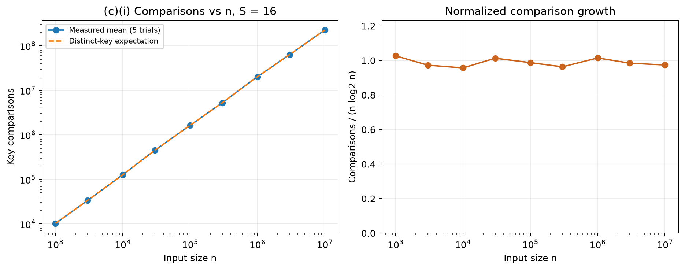
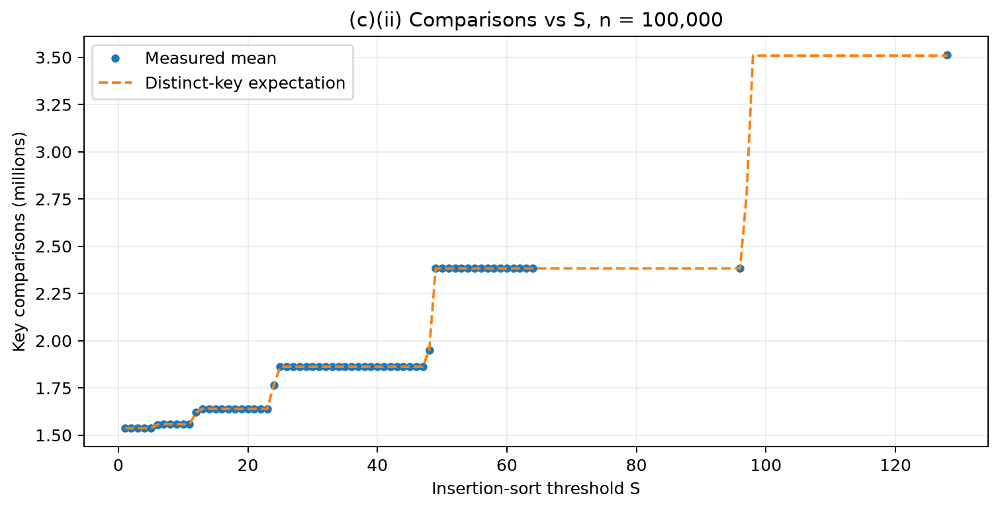
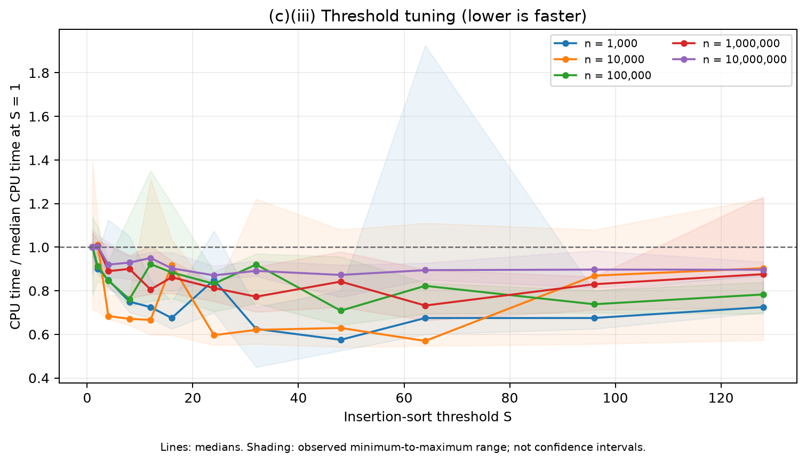
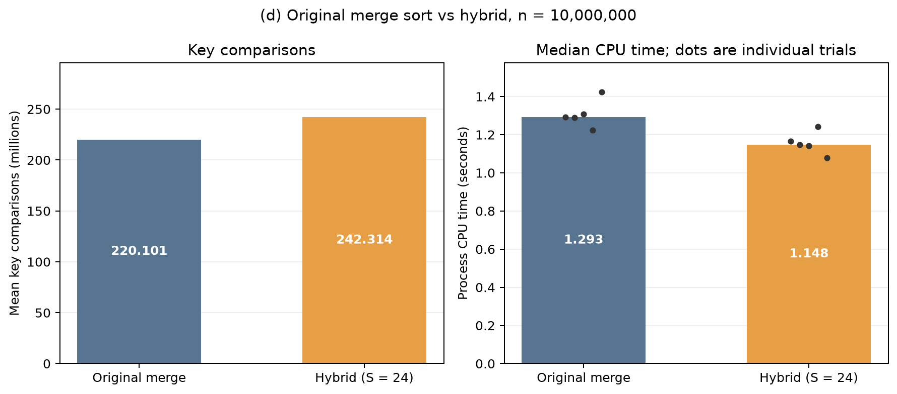

# SC2001 Project 1 Report

*Integration of Merge Sort and Insertion Sort*

This report answers the assignment in order: **A. Algorithm implementation**,
**B. Generate input data**, **C. Analyze time complexity**, and **D. Compare with
original Merge Sort**. Part C contains subquestions C(i), C(ii), and C(iii).
The analysis uses 685 measured sorts on arrays containing up to 10 million integers.

## A. Algorithm implementation

[`src/sorting.cpp`](../src/sorting.cpp) contains the original merge sort and the hybrid algorithm. The
hybrid follows this procedure:

```text
hybrid_sort(array, begin, end, S):
    if end - begin <= S:
        insertion_sort(array[begin:end])
        return
    middle = begin + ceil((end - begin) / 2)
    hybrid_sort(array, begin, middle, S)
    hybrid_sort(array, middle, end, S)
    merge the two sorted subarrays
```

Ranges are half-open: `[begin, end)`. The original merge sort always divides
until each subarray contains at most one element. Both algorithms share the
same merge procedure and reuse a preallocated temporary array. Equal values
are taken from the left subarray first, so the algorithms are stable.

A **key comparison** compares two array values. The counter includes an
insertion-sort comparison that terminates the inner loop. It excludes index
checks, assignments, and copying remaining elements after one merge side is
exhausted. Counts use `std::uint64_t`.

## B. Generate input data

The tested sizes were 1,000; 3,000; 10,000; 30,000; 100,000; 300,000;
1,000,000; 3,000,000; and 10,000,000. Values were generated uniformly from
**[1, 10,000,000]**, so duplicates were allowed. `std::mt19937` and recorded
seeds make the input reproducible within the same C++ standard-library
implementation. Arrays are generated in memory as needed; storing all input
arrays on disk is unnecessary because each seed is saved.

Each setting used **five independently seeded inputs**. All thresholds or
algorithms within a trial used copies of the same input. Threshold order was
shuffled; the final comparison alternated algorithm order. Every sorted output
was compared with `std::sort` outside the timed region.

| Setting | Value |
|---|---|
| CPU | Intel Core i5-13420H |
| Environment | Ubuntu 24.04 under WSL2, x86-64 |
| Compiler | GCC 13.3.0, C++17, `-O2 -Wall -Wextra -Wpedantic` |
| CPU timer | `std::clock`, `CLOCKS_PER_SEC = 1,000,000` |
| Timing summary | Median of five process CPU times |
| Comparison summary | Arithmetic mean of five counts |
| Total measured sorts | 685 |

Sorting time includes comparison-counter updates. Input generation, copying,
scratch allocation, correctness checks, and CSV writing are excluded. Wall time
is recorded separately. The sorting routines are single-threaded. The largest
experiment holds approximately four 40 MB integer arrays, about 160 MB in total.

## C. Analyze time complexity

For a subarray larger than S, the recurrence is

$$
T(n,S)=T(\lceil n/2\rceil,S)+T(\lfloor n/2\rfloor,S)+\Theta(n).
$$

For random distinct keys, an insertion-sort leaf of size m costs
$\Theta(m^2)$ on average, and also in the worst case. There are approximately
$n/S$ leaves and $\log_2(n/S)$ merge levels. Thus, for $1\le S\le n$,

$$
T(n,S)=\Theta\bigl(nS+n\log_2(n/S)\bigr)
$$

in the worst case and under the random-distinct-key average-case model.
For constant S, this becomes **Theta(n log n)**. If S reaches n, the algorithm
becomes insertion sort and can require Theta(n squared) time. On already sorted
input, insertion leaves take linear time, giving
Theta(n + n log(n/S)) for this implementation. Auxiliary array space is O(n),
with O(1 + log(n/S)) recursion depth.

The dashed expectation curves use the actual recursive split sizes. An insertion
leaf of size m has expected count `m(m-1)/4 + m - H_m`, where `H_m` is the harmonic
sum. Merging runs of lengths a and b has expected count
`a + b - a/(b+1) - b/(a+1)`. These formulas assume uniformly shuffled distinct
keys; they are a reference model for our duplicate-containing inputs.

### C(i). Fixed S, varying n

S was fixed at **16**. Selected measurements are shown below; all nine sizes are
included in `results/input_sizes.csv`.

| n | Mean key comparisons | Comparisons / (n log2 n) |
|---:|---:|---:|
| 1,000 | 10,233.4 | 1.027 |
| 10,000 | 127,157.6 | 0.957 |
| 100,000 | 1,640,033.0 | 0.987 |
| 1,000,000 | 20,221,519.6 | 1.015 |
| 10,000,000 | 226,420,296.4 | 0.974 |

The normalized counts remain close to one, consistent with Theta(n log n)
growth. Small fluctuations occur because actual leaf sizes depend on recursive
halving and need not equal S.



### C(ii). Fixed n, varying S

n was fixed at **100,000**. S was tested at every integer from 1 through 64,
followed by 96 and 128.

| S | Mean key comparisons |
|---:|---:|
| 1 | 1,536,460.0 |
| 8 | 1,557,748.0 |
| 16 | 1,639,135.8 |
| 32 | 1,862,168.2 |
| 64 | 2,384,519.0 |
| 128 | 3,511,717.8 |

Larger thresholds eventually increase comparisons because the quadratic work
inside insertion leaves outweighs the saved merge levels. The curve has
plateaus: changing S does nothing if it does not change which recursive
subarrays become leaves. For example, S = 64 and S = 96 produce the same
comparison counts at this n. The measured curve closely follows the
distinct-key expectation.



### C(iii). Selecting an optimal S

The candidate thresholds were **1, 2, 4, 8, 12, 16, 24, 32, 48, 64, 96, 128**.
The smallest median CPU time determined the winner for each size.

| n | Fastest tested S | Median CPU time (seconds) |
|---:|---:|---:|
| 1,000 | 48 | 0.000023 |
| 10,000 | 64 | 0.000449 |
| 100,000 | 48 | 0.006200 |
| 1,000,000 | 64 | 0.077435 |
| 10,000,000 | 24 | 1.091716 |

**S = 24** was selected for part (d), using the largest tuning dataset. This is
the fastest tested candidate in this run, not proof of a unique optimum. At
n = 10 million, S = 24 and S = 32 create the same 19- or 20-element leaves;
their timing difference is measurement variation. S = 48 was also very close
(1.094072 seconds), and the observed time ranges overlap. Small-input rankings
are especially sensitive to timing noise.

The plot normalizes each size by its median time at S = 1. A useful threshold
balances reduced recursion and merging against additional insertion work.
CPU, compiler, input distribution, and actual leaf sizes can change the result.



## D. Compare with original Merge Sort

Five **new seeds**, 520260914 through 520260918, were used for arrays of exactly
10 million integers. Each trial compared both algorithms on identical input;
these seeds were not used for threshold tuning.

| Algorithm | Mean key comparisons | Median CPU time (s) | CPU min-max (s) |
|---|---:|---:|---:|
| Original merge sort | 220,101,381.6 | 1.292713 | 1.223015-1.423818 |
| Hybrid, S = 24 | 242,314,340.8 | 1.147524 | 1.077629-1.243052 |

The CPU-time reduction is
`(1.292713 - 1.147524) / 1.292713 * 100 = 11.23%`, or approximately **1.13x**
speedup. The comparison-count increase is **10.09%**. Hybrid was faster in
four of the five paired trials, so the improvement was not present in every
individual run.



The result is consistent with lower recursion and small-run merge overhead,
despite extra insertion comparisons. Timing alone does not isolate the cost
of each operation. These measurements include instrumentation and were collected
on one machine with five trials; the plotted ranges are observations, not
confidence intervals. Both algorithms remain Theta(n log n) for fixed S.

## Validation and reproducibility

The test program checks hand-counted examples, empty and singleton arrays,
duplicates, ordered and reversed inputs, random inputs, S = 1 equivalence,
large S, and invalid arguments. Optimized and AddressSanitizer/UndefinedBehaviorSanitizer
test builds passed. All 685 measured outputs matched `std::sort`.

[`scripts/check_results.py`](../scripts/check_results.py) independently checks the saved experiment grids, seeds,
counts, timing summaries, and selected thresholds. [README.md](../README.md) gives the commands
to rebuild, rerun, validate, and regenerate all four figures. Raw measurements
and environment details are retained under `results/`.

The repository was subsequently reorganized into `src/`, `tests/`, `scripts/`,
and `docs/`. The measurements in this report are the original recorded run;
the CSVs and figures were preserved. The build command in `environment.txt`
records the source layout used at measurement time; the current build command
is documented in the README.
