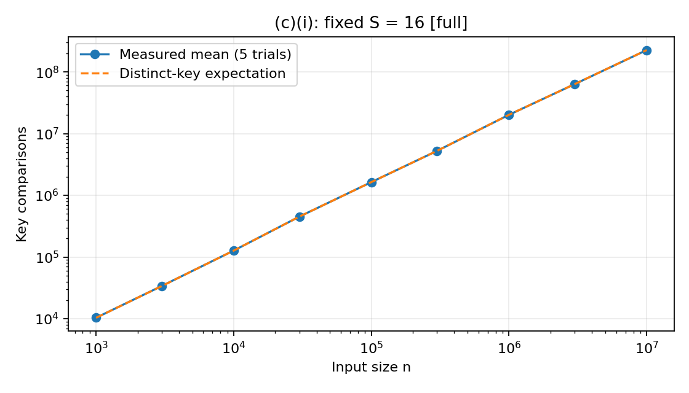
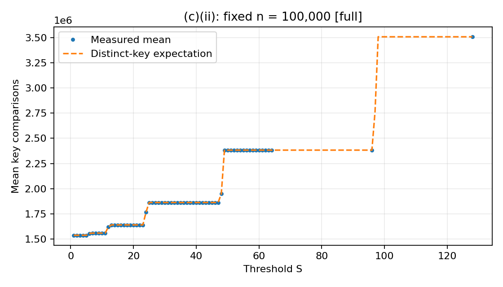
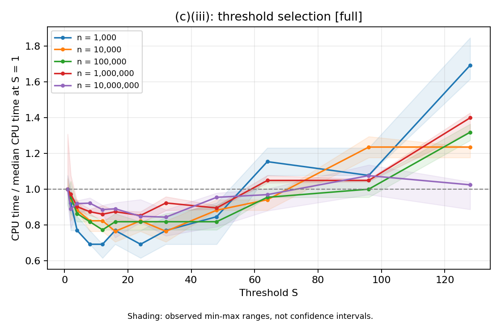

# SC2001 Project 1: Python Experimental Report

## Integration of Merge Sort and Insertion Sort

### Abstract

This study implements insertion sort, merge sort, and a hybrid sorting algorithm
in Python. The hybrid switches to insertion sort when a subarray contains at
most S elements. Four experiments examine comparison growth, the effect of S,
CPU-based threshold selection, and performance against original merge sort.
The full study contains 685 measurement records, with five independently seeded
trials per setting and inputs up to 10,000,000 integers.

At the largest tuning size, the fastest tested candidate was S = 32. On fresh
10,000,000-element inputs, its median CPU time was 32.40625 seconds, compared
with 36.125 seconds for merge sort: a 10.29% reduction. The hybrid performed
10.09% more key comparisons and was faster in four of five paired trials.
These findings illustrate that comparison counts alone do not determine runtime.

## A. Algorithm implementation

The executable implementation and saved outputs are in
[Project_1.ipynb](Project_1.ipynb). Each sorting function returns the sorted list
and its key-comparison count.

Insertion sort maintains a sorted prefix and inserts each successive element
by shifting larger elements to the right. Merge sort recursively splits its
input, sorts both halves, and merges them. The left half receives the extra
element when the input length is odd. The hybrid uses the following procedure:

```text
hybrid_sort(A, S):
    if length(A) <= 1:
        return A, 0
    if length(A) <= S:
        return insertion_sort(A)
    middle = ceil(length(A) / 2)
    left, left_count = hybrid_sort(A[:middle], S)
    right, right_count = hybrid_sort(A[middle:], S)
    result, merge_count = merge(left, right)
    return result, left_count + right_count + merge_count
```

Original merge sort divides until every subarray has at most one element.
Both recursive algorithms share the same merge function. Equal values are taken
from the left side first, and insertion sort shifts only strictly larger values;
these rules preserve stability. With S = 1, the hybrid follows merge sort's
comparison decisions. With S at least the input length, it uses insertion sort
for the entire nontrivial input.

A **key comparison** compares two input values. The counter includes the
comparison that terminates insertion sort's inner loop, but excludes index
checks, assignments, and copying the remainder of an exhausted merge. Recursive
counts are added to the count from the merge. Disabling counting preserves the
sorted result and returns zero comparisons.

The implementation uses Python list slices and allocates merged result lists.
These allocations are part of the algorithm being measured; it does not reuse
a preallocated merge buffer.

## B. Input generation and experimental method

Inputs contain uniformly generated random integers from **[1, 10,000,000]**,
with duplicates allowed. Each trial uses `random.Random(seed)` and `randint`.
Within a trial, every threshold or algorithm receives an independent copy of
the same original input. The seed is calculated as:

```text
BASE_SEED + experiment_offset + 10 * n + trial
```

`BASE_SEED` is 20260913; trial numbers run from 1 to 5. Experiment offsets are
100000000, 200000000, 300000000, and 400000000 for C(i), C(ii), C(iii), and D,
respectively. Seeds and settings are retained in the
[raw measurements](recorded_results/full/raw_measurements.csv) and
[configuration](recorded_results/full/settings.json).

| Experiment | Sizes or settings | Records |
|---|---|---:|
| C(i): fixed S = 16 | Nine sizes from 1,000 to 10,000,000 | 45 |
| C(ii): fixed n = 100,000 | S = 1 through 64, then 96 and 128 | 330 |
| C(iii): threshold tuning | Five sizes, twelve thresholds per size | 300 |
| D: final comparison | Two algorithms, n = 10,000,000 | 10 |
| **Total** | **Five trials per setting** | **685** |

### Timing and validation

The recorded environment was **Python 3.13.7 on Windows**. CPU time was measured
using `time.process_time`; elapsed time was separately measured using
`time.perf_counter`. The timed interval includes sorting with comparison counting
enabled, internal slicing and list allocation, and timing-loop overhead. Input
generation, external input copying, reference sorting, output validation, and
file writing are excluded.

For n below 1,000,000, short sorts are batched. The number of prepared copies is
`min(200, max(1, ceil(200000 / n)))`; the measured duration is divided by this
number. Larger inputs are timed individually. Thus, 685 is the number of
measurement records, not the number of individual sorting calls. Each record's
`timed_sorts` field identifies its batch size.

Both recursive algorithms receive an untimed warm-up. Threshold order is shuffled
within each trial. The final comparison alternates execution order: hybrid first
on odd trials, merge sort first on even trials. Summary tables use arithmetic
means for comparisons and medians for CPU and elapsed times. Minimum and maximum
CPU times describe observed variation, not confidence intervals.

Every measured output was checked against Python's `sorted()` outside the timed
interval. For a batch, comparison counts also had to agree across identical
inputs. Correctness and hand-counted instrumentation tests passed for empty,
singleton, ordered, reversed, duplicate-containing, and odd-length inputs, as
well as the S = 1 and large-S equivalence cases. All 685 records passed output
validation.

### Execution continuity

The run was interrupted after 663 records. Those records were preserved exactly;
only the remaining 22 were measured after resuming in the same Python version
and operating system. The first session completed C(i), C(ii), all smaller-size
tuning, and four tuning trials at n = 10,000,000. The second session completed
the fifth large-size tuning trial and all five final paired comparisons.
This boundary is recorded in the configuration and is a limitation when
interpreting small timing differences between thresholds.

## C. Complexity analysis and threshold experiments

For a subarray larger than S, the recurrence is

$$T(n,S)=T(\lceil n/2\rceil,S)+T(\lfloor n/2\rfloor,S)+\Theta(n).$$

For 1 <= S <= n, there are approximately n/S insertion-sort leaves and
log2(n/S) merge levels. In the worst case, insertion sorting the leaves costs
O(nS), and the merge levels cost O(n log2(n/S)), giving

$$T(n,S)=O\bigl(nS+n\log_2(n/S)\bigr).$$

For fixed S, this gives O(n log n); when S reaches n, the algorithm becomes
insertion sort and can require quadratic time. Ordered insertion leaves need
only linear work, so input order matters. Peak auxiliary storage for the sorting
implementation is O(n), with O(1 + log2(n/S)) recursion depth. The experimental
driver additionally stores reference data, copies, and batch outputs.

The comparison-count reference model assumes uniformly shuffled **distinct**
keys and follows the actual ceil/floor partition sizes. For an insertion leaf
of size m, the expected count is

$$E[I_m]=m(m-1)/4+m-H_m,\qquad H_m=\sum_{k=1}^{m}1/k.$$

For merging sorted runs of lengths a and b, the expected count is

$$E[M_{a,b}]=a+b-\frac{a}{b+1}-\frac{b}{a+1}.$$

The notebook applies these expressions recursively. They describe expected
comparison counts, not worst-case bounds. Because generated inputs can contain
duplicates, the model is an idealized reference rather than an exact prediction.

### C(i). Fixed S, varying n

With **S = 16**, all nine input sizes were tested:

| n | Mean key comparisons | Comparisons / (n log2 n) |
|---:|---:|---:|
| 1,000 | 10,355.4 | 1.039 |
| 3,000 | 33,893.2 | 0.978 |
| 10,000 | 127,164.2 | 0.957 |
| 30,000 | 451,819.0 | 1.013 |
| 100,000 | 1,639,306.4 | 0.987 |
| 300,000 | 5,257,847.8 | 0.963 |
| 1,000,000 | 20,225,431.6 | 1.015 |
| 3,000,000 | 63,551,867.6 | 0.985 |
| 10,000,000 | 226,419,298.4 | 0.974 |



The normalized counts remain between approximately 0.957 and 1.039, consistent
with n log n growth over the measured range. The measured means closely follow
the expectation curve. Small fluctuations reflect actual leaf sizes, random
input variation, and duplicates. These observations support the theoretical
analysis but do not themselves prove an asymptotic bound.

Source: [size-scaling analysis](recorded_results/full/input_sizes_analysis.csv).

### C(ii). Fixed n, varying S

With **n = 100,000**, each integer S from 1 through 64 was tested, followed by
96 and 128. Selected results are:

| S | Mean key comparisons |
|---:|---:|
| 1 | 1,536,389.0 |
| 8 | 1,557,848.8 |
| 16 | 1,639,252.6 |
| 32 | 1,861,950.4 |
| 64 | 2,381,412.8 |
| 96 | 2,381,412.8 |
| 128 | 3,509,936.4 |



Increasing S removes recursive divisions and merge levels but enlarges the
insertion-sort leaves. Eventually, the extra insertion comparisons outweigh
the saved merge comparisons. The curve has plateaus because recursive subarray
sizes are discrete: S = 64 and S = 96 both stop at 48- or 49-element leaves and
therefore produce identical comparison counts. Runtime must be measured
separately because recursion, allocations, and element movement also have costs.

Source: [complete threshold sweep](recorded_results/full/threshold_sweep.csv).

### C(iii). Selecting S using CPU time

The candidate thresholds were **1, 2, 4, 8, 12, 16, 24, 32, 48, 64, 96, 128**.
For each input size, the lowest median CPU time determined the winner; exact
ties were resolved by choosing the smaller S.

| n | Selected S | Median CPU time (seconds) |
|---:|---:|---:|
| 1,000 | 8 | 0.000703125 |
| 10,000 | 16 | 0.01015625 |
| 100,000 | 12 | 0.1328125 |
| 1,000,000 | 24 | 1.90625 |
| 10,000,000 | 32 | 32.4375 |



Each line is normalized by that size's median CPU time at S = 1. Shading shows
observed minimum-to-maximum ranges. **S = 32** was selected for part D because
it won at the largest tuning size.

This is not evidence of a unique optimum. At n = 10,000,000, S = 24 and S = 32
produce the same 19- or 20-element leaves and the same mean comparison count,
242,320,327.2. Their median CPU times were 32.609375 and 32.4375 seconds, with
overlapping ranges of 31.34375-36.21875 and 28.40625-34.0 seconds, respectively.
Such structurally equivalent configurations can have different measured times.

The fastest candidate also did not minimize comparisons: S = 1 used
220,100,460.8 mean comparisons but had a median CPU time of 38.4375 seconds.
The selected threshold varies across sizes, and small timing differences should
be interpreted cautiously, especially given the resumed tuning session.

Sources: [tuning measurements](recorded_results/full/threshold_tuning.csv) and
[selected thresholds](recorded_results/full/best_threshold.csv).

## D. Original merge sort versus the selected hybrid

The final comparison used **10,000,000 integers**, hybrid **S = 32**, and five
new seeds: 520260914 through 520260918. None of these seeds was used for tuning.
Both algorithms received identical input within each trial.

| Algorithm | Mean key comparisons | Median CPU time (s) | Observed CPU range (s) |
|---|---:|---:|---:|
| Original merge sort | 220,101,680.0 | 36.125 | 35.453125-40.609375 |
| Hybrid, S = 32 | 242,316,014.8 | 32.40625 | 32.203125-36.328125 |

The CPU-time reduction is

$$\frac{36.125-32.40625}{36.125}\times100\%=10.29\%.$$

The ratio of median CPU times is **1.115x**. The comparison-count change is

$$\frac{242316014.8-220101680.0}{220101680.0}\times100\%=+10.09\%.$$

Median elapsed times were approximately 36.659 seconds for merge sort and
32.851 seconds for the hybrid. Individual paired CPU times were:

| Trial | Merge CPU time (s) | Hybrid CPU time (s) | Faster algorithm |
|---:|---:|---:|---|
| 1 | 36.125 | 36.328125 | Merge |
| 2 | 35.640625 | 32.203125 | Hybrid |
| 3 | 35.453125 | 32.40625 | Hybrid |
| 4 | 36.328125 | 33.40625 | Hybrid |
| 5 | 40.609375 | 32.296875 | Hybrid |

The hybrid was faster in **four of five** paired trials, rather than every run.
The 10.29% figure is a reduction computed from two medians; it is not an average
of the five per-trial percentage reductions.

Sources: [comparison summary](recorded_results/full/merge_comparison.csv) and
[paired measurements](recorded_results/full/merge_comparison_paired.csv).

## Discussion and conclusion

The full Python study supports three main observations. First, with a constant
threshold, comparison growth is consistent with n log n. Second, increasing S
eventually raises comparisons as insertion-sort leaves become larger. Third,
minimizing comparisons does not necessarily minimize measured CPU time.

Using S = 32 reduced median CPU time by 10.29% on fresh 10,000,000-element
inputs, despite 10.09% more comparisons. Reduced recursion and small-subarray
merge overhead are plausible explanations, but the experiment did not isolate
the cost of individual operations. It therefore cannot attribute the entire
improvement to one specific mechanism.

Several limitations qualify this result:

- Timings include comparison counting and Python list-allocation overhead;
  they do not measure uninstrumented implementations.
- Batching reduces short-interval timer effects, but timing variation remains.
  Minimum-to-maximum ranges are not confidence intervals.
- Threshold tuning spans two execution sessions. The selected S is the best
  measured candidate, not a universal or uniquely established optimum.
- The performance study uses random integers with possible duplicates. Ordered
  and reversed inputs were tested for correctness, not as performance workloads.
- Five trials in one recorded environment do not establish statistical
  significance or performance guarantees on other machines or distributions.

## Reproducibility and supporting files

Open [Project_1.ipynb](Project_1.ipynb), keep `FULL_RUN = True`, restart the
kernel, and run the cells in order. See [the usage instructions](README.md)
for dependencies. The full experiment can take substantial time and memory;
`FULL_RUN = False` is only a reduced workflow check and does not reproduce the
full results in this report.

The [archived full run](recorded_results/full/) contains raw records, summaries,
configuration, selected thresholds, and the three figures shown above. New runs
are written to separate `results/full/` directories and do not overwrite this
archive. Recorded seeds reproduce inputs in the same Python environment;
timings are expected to vary. The archive's 685 records, experiment grids,
seeds, timing summaries, paired outcomes, and threshold selection were checked
independently without rerunning the sorts.
