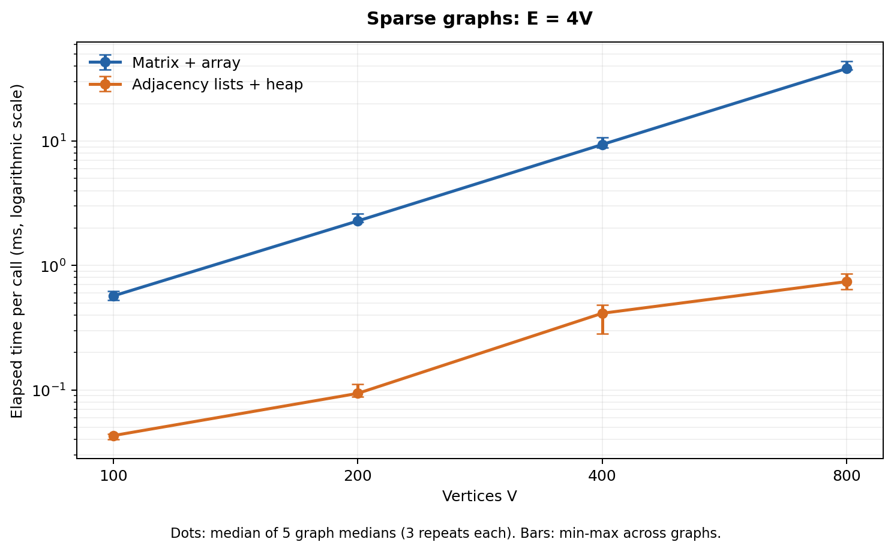
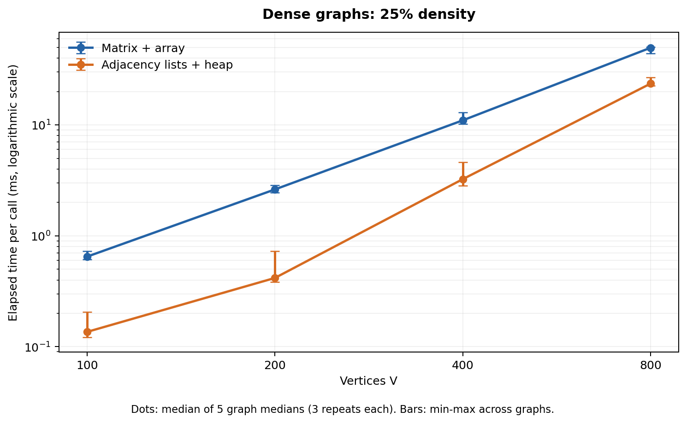
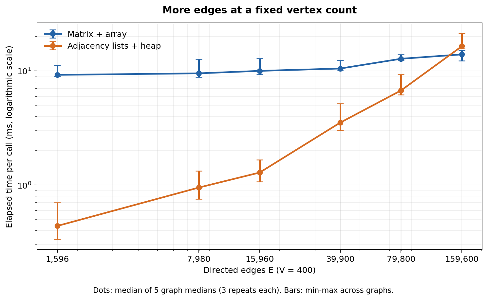

# Project 2: Dijkstra's Algorithm

[Project_2.ipynb](Project_2.ipynb) compares Dijkstra implemented with an
adjacency matrix and array priority queue against adjacency lists and a
binary min-heap. It includes theoretical analysis, correctness checks,
three timing experiments, saved plots, and a discussion of the measurements.

## Run the notebook

From the repository root:

```sh
cd "Project 2"
python -m pip install -r requirements.txt
python -m jupyterlab Project_2.ipynb
```

Python 3.13.7 was used for the recorded run. Run the cells from top to bottom.
Saved outputs can be viewed without rerunning. Fresh runs create a uniquely
named directory under `results/`; they do not overwrite `recorded_results/`.

## Experimental settings

| Experiment | Vertices V | Directed edges E |
|---|---|---|
| Sparse scaling | 100, 200, 400, 800 | E = 4V |
| Dense scaling | 100, 200, 400, 800 | E = floor(0.25 V(V-1)) |
| Edge sweep | 400 | Densities 1%, 5%, 10%, 25%, 50%, 100% |

Density is E/[V(V-1)]. Graphs have no self-loops or parallel edges, use
uniformly sampled integer weights from 1 to 100, and are reachable from
source vertex 0. A planted outward tree guarantees reachability; the graph
distribution is not uniform over all connected directed graphs. At a fixed
V and seed, adding edges preserves existing edges and weights.

Each setting uses five fixed graph seeds. Both implementations receive the
same graph and source, get one untimed warm-up, and run three timed repeats
with alternating order. Case order is shuffled using a separate fixed seed.
Graph generation, representation conversion, correctness checks and plotting
are outside the `perf_counter_ns` timing region. Normal garbage collection
remains enabled.

The reference run contains 14 settings, 70 graph cases and 420 timed calls.
Some settings overlap between experiment families. Independent Bellman-Ford
checks passed for 715 small graph/source combinations, and all 420 timed
outputs agreed between the two implementations.

## Recorded results

| Setting | Matrix + array (ms) | Adjacency lists + heap (ms) |
|---|---:|---:|
| V=800, E=3,200 | 38.290 | 0.742 |
| V=800, density=25% | 49.584 | 23.554 |
| V=400, density=1% | 9.239 | 0.439 |
| V=400, density=50% | 12.784 | 6.744 |
| V=400, density=100% | 13.959 | 16.461 |

Times are medians across five per-graph medians, each based on three repeats.
Plot error bars are the minimum and maximum of those five medians, not
confidence intervals. The `speedup` column in the CSV is the median of the
five paired matrix/heap ratios; it need not equal the ratio of the two
aggregate timing medians.

The heap version was faster in 13 of 14 settings and 65 of 70 graph cases.
The matrix version was faster for all five complete-graph cases at V=400.
These results support using the heap for sparse graphs and considering the
matrix for very dense graphs. They do not establish a universal crossover
density. Timings depend on the machine, Python implementation, warm-up policy,
graph structure and weights. Only the software versions and OS family are
recorded; device identifiers and execution timestamps are omitted.







## Supporting data

- [Raw timings](recorded_results/raw_timings.csv): all 420 timed calls.
- [Per-graph medians](recorded_results/per_graph_medians.csv): 70 paired cases.
- [Summary](recorded_results/summary.csv): 14 parameter settings and ranges.
- [Graph manifest](recorded_results/graph_manifest.csv): seeds, source and hashes.
- [Environment and settings](recorded_results/environment.json): reproducibility metadata.

The matrix version has worst-case Theta(V^2) time. The heap version retains
old entries after successful relaxation and skips stale entries when popped;
its bound is O(V + E log(E+1)), or O(V + E log V) for simple graphs. The
notebook derives these bounds and explains why actual dense-graph timings
do not necessarily attain the heap version's upper bound.
